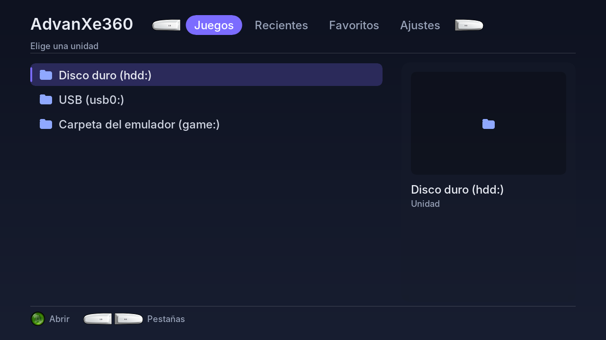

# Apariencia-Emulador

The user interface of [AdvanXe360](https://github.com/ZenithUzu/AdvanXe360), split out from the emulator so it can be used in **other Xbox 360 emulators**. It covers the menu, the Library with box art, themes, music, achievement pop-ups, and online box art and cheats.

*[Español](README.md)*

## Contents

- **`ui/`**: the whole interface: Library, menus, Settings, keyboard, themes, background effects, pop-ups, fonts and button images. It draws into a 1280×720 image (`UiCanvas`). This is plain C++ that builds with VS2010 and on a PC.
- **`xbox/`**: the Xbox 360 side. It shows the menu and the in-game pop-up, loads images and plays music. It also handles HTTPS (BearSSL), online box art and cheats, and RetroAchievements.
- **`dependencias/`**: BearSSL and rcheevos, with VS2010 projects set up for the Xbox.
- **`ejemplo-pc/`**: a PC simulator that runs the interface with a fake emulator. Use it to preview changes, and as a model of how to connect the interface to an emulator.
- **`herramientas/`**: font generator and accent escaper.

## Using it in another emulator

1. **Name and credits.** Edit `ui/UiMarca.h` and `ui/UiMarca.cpp` (the About page). Nothing else in `ui/` names the emulator.
2. **Connect your emulator.** Implement `UiHost` (`ui/UiHost.h`). `ejemplo-pc/simulador.cpp` (`FakeHost`) is a small, complete example.
3. **Xbox side.** Provide the functions listed in the second half of `xbox/XboxPlataforma.h`. These are a few emulator functions plus the video and audio hooks from **libSDLx360**.
4. **Replace the Game Boy parts:**
   - `ui/UiCartArt.cpp` (cartridge art).
   - `ui/UiGbPalettes.cpp`.
   - The GB options in `UiConfig.h` and `UiApp.cpp`.
   - The libretro folder names in `xbox/XboxCovers.cpp`.
5. **Achievements.** Call `cheevosGameStarted(RC_CONSOLE_..., rom, size, readByte)`. `readByte` reads the game memory as RetroAchievements numbers it.
6. **VS2010.** Add the `.cpp` files and the two projects in `dependencias/`. Zipped cheat packs also need File_Extractor (fex), which lives in AdvanXe360.

Try it on a PC with `cd ejemplo-pc && make demo`.

## Licenses

The code is **MIT** (`LICENSE`), with these exceptions (see `licencias/`):

- `ui/UiGbPalettes.cpp` is **GPL v2**, because its palettes come from Gambatte.
- `ui/UiFontData.h` is the **Inter** typeface, under **SIL OFL 1.1**.
- `ui/UiGlyphs.cpp` holds Microsoft's XNA button images, under **Ms-PL**.
- The Mozilla root certificates are **MPL 2.0**.
- BearSSL and rcheevos are **MIT**.

## Credits

- **ZenithUzu (ZenithARC)**: design and console testing, programmed with **Claude (Anthropic)**.
- **Microsoft (XNA Game Studio)**: button images.
- **Rasmus Andersson / The Inter Project Authors**: the Inter typeface.
- **RetroAchievements**: rcheevos.
- **RetroArch / libretro**: the pop-up style.
- **Thomas Pornin**: BearSSL.
- **Mozilla**: root certificates.
- **libretro**: libretro-thumbnails and libretro-database.
- **davidgfnet**: superfw-cheats.
- **frankischilling**: snes360-enhanced, the water effect idea.
- **Sindre Aamås / libretro**: Gambatte palettes.
- **The Xbox 360 scene**: libSDLx360, the VBA360 authors, Team Avalaunch, Team XeLove.

Please keep these credits when you use the interface, and add your own.
