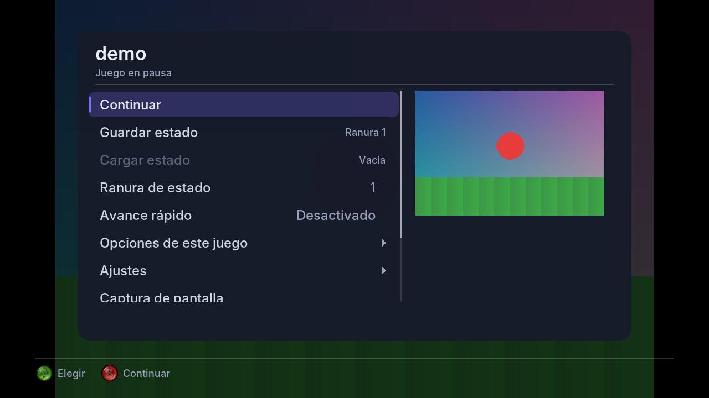

# Apariencia-Emulador

La interfaz de [AdvanXe360](https://github.com/ZenithUzu/AdvanXe360) (menú, Biblioteca con carátulas, temas, música, avisos de logros, carátulas y trucos por internet) separada del emulador, para usarla en **otros emuladores de Xbox 360**.

*[English](README.en.md)*

| Biblioteca y pestañas | Menú dentro del juego |
|---|---|
|  |  |

*Capturas del ejemplo para PC (`ejemplo-pc/`), sin consola ni emulador.*

## Qué trae

| Carpeta | Qué es | ¿Depende de la consola? |
|---|---|---|
| `ui/` | Toda la interfaz: Biblioteca, menús, Ajustes, teclado, temas, efectos de fondo, avisos, fuentes y botones. Dibuja en una imagen de 1280×720 (`UiCanvas`). | No: es C++ normal (compila en VS2010 y en PC). |
| `xbox/` | Lo de Xbox 360: mostrar el menú en pantalla, el aviso sobre el juego, cargar imágenes, música, HTTPS (BearSSL), carátulas y trucos por internet, y RetroAchievements. | Sí (XDK). |
| `dependencias/` | BearSSL (HTTPS) y rcheevos (logros), con sus proyectos de VS2010 ya preparados para la Xbox. | — |
| `ejemplo-pc/` | Un simulador: la interfaz corriendo en PC con un emulador de mentira. Sirve para ver cambios sin consola y como modelo de cómo conectarla. | No. |
| `herramientas/` | `genfont.py` (regenera las fuentes) y `escape_latin1.py` (acentos en el código). | — |

## Adaptarlo a otro emulador

1. **Nombre y créditos** (lo primero): cambia `ui/UiMarca.h` (nombre, versión, archivo de ajustes, dónde están las versiones) y `ui/UiMarca.cpp` (la página *Acerca de*: qué emula, qué no y los créditos). Fuera de esos dos archivos, la interfaz no menciona al emulador.
2. **Conecta la interfaz a tu emulador** implementando `UiHost` (`ui/UiHost.h`): listar carpetas, cargar o guardar estados, trucos, capturas, la imagen del juego, etc. Muchas funciones ya traen una versión vacía, así que puedes empezar con pocas. `ejemplo-pc/simulador.cpp` (`FakeHost`) es un ejemplo completo y pequeño.
3. **La parte de Xbox**: tu emulador da las funciones de la segunda mitad de `xbox/XboxPlataforma.h`. Son la carpeta del emulador, su `UiHost` y `g_cfg`, más unos *hooks* de video y audio que vienen de **libSDLx360**. Si tu emulador también usa libSDLx360, ya los tienes.
4. **Lo que es de Game Boy** y cambias por lo de tu consola:
   - `ui/UiCartArt.cpp`: los cartuchos dibujados de la Biblioteca (GBA, GBC, GB).
   - `ui/UiGbPalettes.cpp`: las paletas de Game Boy. Quítalo si no es Game Boy.
   - En `ui/UiConfig.h` y `ui/UiApp.cpp`: las opciones de Game Boy (paleta, Super Game Boy, impresora, color de GBA).
   - En `xbox/XboxCovers.cpp`: las carpetas de carátulas (`"Nintendo - Game Boy Advance"`…) y de trucos de libretro.
5. **Logros**: al iniciar un juego, llama a `cheevosGameStarted` con el número de consola de rcheevos, la ROM y una función que lea la memoria del juego como la numera RetroAchievements (ver el mapa de memoria de cada consola en [docs.retroachievements.org](https://docs.retroachievements.org)). Ejemplo para NES:

   ```cpp
   bool leerMemoria(unsigned dir, unsigned char &out)
   {
     if (dir >= 0x800) return false;   // NES: 2 KB de RAM
     out = ramDeMiEmulador[dir];
     return true;
   }
   ...
   cheevosGameStarted(RC_CONSOLE_NINTENDO, rom, tamano, leerMemoria);
   ```

   Después, llama a `cheevosFrame()` en cada cuadro emulado, a `cheevosIdle()` con el juego en pausa y a `cheevosGameExited()` al salir.
6. **Proyecto de VS2010** (Xbox 360):
   - Agrega los `.cpp` de `ui/` y `xbox/`.
   - Agrega `dependencias/BearSSL/BearSSL.vcxproj` y `dependencias/rcheevos/rcheevos.vcxproj` como referencias.
   - Agrega a *Include Directories* `dependencias/BearSSL/inc` y `dependencias/rcheevos/include`.
   - Los paquetes de trucos `.zip` usan **File_Extractor (fex)**, que no viene aquí: está en AdvanXe360, en `dependencies/File_Extractor-1.0.0`.

## Probar en PC

Solo necesitas `g++`:

```
cd ejemplo-pc
make demo
```

Las capturas quedan en `ejemplo-pc/capturas/` (formato `.ppm`). El guion `demo.txt` dice qué botones pulsar; los comandos posibles están explicados al principio de `simulador.cpp`.

## Licencias

- **El código de este repositorio: MIT** (`LICENSE`). Lo puedes usar en cualquier emulador, incluso uno que no sea GPL.
- **Excepciones**, cada una con su licencia en `licencias/`:
  - `ui/UiGbPalettes.cpp`: **GPL v2**. Las paletas de Game Boy vienen de Gambatte. Si tu emulador no es GPL, no uses este archivo.
  - `ui/UiFontData.h`: la fuente **Inter**, con licencia **SIL Open Font License 1.1** (`licencias/Inter-OFL.txt`).
  - `ui/UiGlyphs.cpp`: las imágenes de los botones del control, del paquete **XNA Game Studio** de Microsoft, con licencia **Ms-PL** (`licencias/XNA-botones-MsPL.txt`). Están redimensionadas, y LB/RB están reflejados.
  - `xbox/XboxTlsRoots.inc`: los certificados raíz de **Mozilla** (vía certifi, MPL 2.0).
  - `dependencias/BearSSL`: **MIT** (Thomas Pornin).
  - `dependencias/rcheevos`: **MIT** (RetroAchievements). En `xbox/` y `src/rc_compat.*` tiene pequeños ajustes para VS2010.

## Créditos

- **Interfaz**: ZenithUzu (ZenithARC), idea, diseño y pruebas en consola; programada con ayuda de **Claude (Anthropic)** para AdvanXe360.
- **Botones del control**: Microsoft, paquete *Xbox 360 Controller Button Images* de XNA Game Studio (Ms-PL).
- **Fuente**: Inter, de Rasmus Andersson y The Inter Project Authors (SIL OFL 1.1).
- **Logros**: rcheevos de RetroAchievements (MIT). Los logros y el servidor son de [retroachievements.org](https://retroachievements.org) y su comunidad.
- **Aviso de logros**: hecho como el de **RetroArch** (libretro). Su sonido `unlock`, de ViRiX Dreamcore (CC BY-NC 3.0), no viene incluido.
- **HTTPS**: BearSSL de Thomas Pornin (MIT), con los certificados raíz de Mozilla.
- **Carátulas y trucos**: se descargan de [libretro-thumbnails](https://github.com/libretro/libretro-thumbnails) y [libretro-database](https://github.com/libretro/libretro-database) (la comunidad de libretro), y de [superfw-cheats](https://github.com/davidgfnet/superfw-cheats) (davidgfnet).
- **Efecto de agua**: la idea viene de snes360-enhanced (frankischilling).
- **Paletas de Game Boy**: Gambatte, de Sindre Aamås y el equipo de libretro (GPL v2).
- **Escena de Xbox 360**: libSDLx360, los autores de VBA360, Team Avalaunch y Team XeLove.

Si usas esta interfaz en tu emulador, deja estos créditos (en `UiMarca.cpp` ya vienen en *Acerca de*) y agrega los tuyos.
